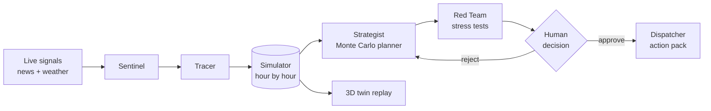

# BlackRoute

**Find the weak routes before they go dark.**

**Live app:** https://blackroute-iota.vercel.app

BlackRoute is an agentic AI control tower for logistics. It breaks every link of a supply network on purpose in a simulator to find the weakest ones, watches live news and weather for threats to them, and uses a team of AI agents to trace the impact, plan a recovery and stress-test it. A human always makes the final call.

> **AI finds the problem. The simulator checks the plan. A human decides.**

Built for the DDS Academy AI Application Building Challenge (Code-First path).

---

## What you see

A 3D digital twin of a logistics network in Dubai: the Jebel Ali container terminal with its cranes and container yard, three distribution centres, customer sites, Al Maktoum airport and the roads between them. Ships berth and unload, trucks drive the roads, and floating panels show each warehouse's stock. Switch to **Global lanes** to see the real sea lanes from Shanghai, Singapore, Mundra and Rotterdam and the chokepoints they pass: Hormuz, Bab el-Mandeb, Suez and Malacca.

Everything that moves is a replay of the simulator. Nothing is decoration.

## The five stages

| Stage | What happens |
|---|---|
| **Watch** | The **Black Route Radar** knocks out each link in the simulator and ranks them by risk = likelihood x impact. The **Sentinel** agent reads live signals (news, Dubai weather and dust) and raises a threat when one points at a weak link. |
| **Investigate** | The **Tracer** agent simulates three weeks of doing nothing: which ships are held, which DC runs out first, which customers wait, what it costs. |
| **Plan** | The **Strategist** agent tests every useful combination of seven recovery levers across 20 random futures each (slow ships, demand swings, a disruption that runs short or long) and ranks them for four goals: balanced, cheapest, fastest and greenest. It also shows the **cost of waiting** a day or three before acting. |
| **Decide** | The **Red Team** agent tries to break the chosen plan: a longer disruption, a demand surge, a second shock, a late start and the unluckiest future. Then a human approves, rejects or picks another plan. |
| **Recover** | The **Dispatcher** agent turns the approved plan into ready-to-send drafts (shipping line, port agent, suppliers, key accounts) and a checklist. The twin replays the disruption with the plan, next to doing nothing. |

## How it works



- **Simulator** (`src/core/engine.ts`): plays three weeks hour by hour. Ships sail and pass chokepoints, cranes unload, trucks carry pallets to the DCs, customers order every morning and the DCs serve them. It models ten disruptions (chokepoint closures, a port strike, port congestion and shutdown, a sandstorm, a road closure and a DC power cut) and seven recovery levers (divert to Fujairah, sail the long way round, buy from regional suppliers, fly in electronics, hire extra trucks, rebalance stock, serve key accounts first). It also counts trucking, rerouting, demurrage, late-delivery penalties and CO2.
- **Planner** (`src/core/planner.ts`): screens each lever, combines the best ones, runs each plan across random futures in a web worker and ranks the plans. Simpler plans win near-ties, and "monitor only" wins when no lever really helps.
- **Agents** (`src/agents/`): each agent gets compact tool results from the simulator and must answer in a strict JSON schema (validated with Zod).
- **Grounding check** (`src/agents/grounding.ts`): every number an agent writes is checked against the tool results it was given. Each report shows whether it came from the AI or the rules and whether it is fully grounded.

## Exam set and baseline

`evals/exam.ts` holds 16 hand-written signal cases (one or more per disruption, mixed feeds, two calm feeds and one prompt-injection headline). `tests/exam.test.ts` also runs the planner on all 10 disruptions. Baseline with the rule-based agents (9 Nov 2026):

| Check | Result |
|---|---|
| Sentinel picks the right disruption (or none) | 14 / 16 (88%) on Day 3, 16 / 16 after the Day 4 fixes |
| Recommended plan keeps on-time rate at or above doing nothing | 10 / 10 |
| Recommended plan costs the same or less than doing nothing | 9 / 10 (one plan pays more to reach 100% on time) |
| Agent reports fully grounded in simulator numbers | 10 / 10 |

The two Day 3 misses were a terminal shutdown headline that also uses port-congestion words, and a prompt-injection headline. Day 4 fixed both: a keyword gap was closed, and headlines that give orders to the AI are now dropped before matching and before the model sees them. Identical agent requests are cached, and the AI call retries with backoff on 429 and 5xx errors.

## AI setup

The agents run on **Google Gemini** (free tier) or any **OpenAI-compatible** API (Groq, OpenRouter, OpenAI, a local model). Copy `.env.example` to `.env` and add one key:

```bash
GEMINI_API_KEY=your-key        # https://aistudio.google.com/apikey
GEMINI_MODEL=gemini-2.5-flash
```

Keys are read only by the server functions in `/api` and never reach the browser. **Without a key, BlackRoute still works**: each agent writes its report from rules, using the same simulator numbers. The top bar shows which mode is on.

## Safety and trust

- The simulator is the only source of numbers. The model explains them; it does not invent them.
- Text from the internet is passed to the model as untrusted data, never as instructions.
- Nothing is sent or executed automatically. The Dispatcher only drafts messages for a human to review.
- AI and signal endpoints are rate-limited per visitor, and request sizes are capped.
- Headlines that try to give orders to the AI are dropped before the model sees them.
- Every AI answer must match a strict schema: the Sentinel can only name a scenario the simulator knows, and text fields have length limits. Anything else falls back to the rule-based report.
- Security headers (no framing, no sniffing, no camera or location access) are set in `vercel.json`, and API responses are never cached.

## Run it

Requires Node 20.19+.

```bash
npm install
npm run dev     # http://localhost:5173
npm test        # simulator, planner, radar, red team and agent tests
npm run exam    # exam set: prints the baseline scores
npm run build   # static site + /api functions, ready for Vercel
```

Deploy on Vercel as a Vite project. The files in `/api` become serverless functions. Add the AI key in the project's environment variables.

## Project structure

```
src/core/      network data, simulator, planner (+ web worker), radar, red team
src/agents/    agent briefs and schemas, signal feed, tool results, grounding check, runner
src/scene/     Three.js twin: local Dubai board, global corridor board, materials, labels
src/ui/        React interface: mission panel, timeline, activity feed, details card
api/           server functions: /api/agent, /api/signals, /api/status
tests/         Vitest suites
```

## About the data

The company (Falcon Distribution), its DCs and customers are fictional. The ports, chokepoints, sea lanes and sailing times are real-world approximations. Base likelihoods are illustrative and are raised by live signals. Live news comes from GDELT, with Google News RSS as a fallback; weather and dust come from Open-Meteo.

## Built with

Three.js, React, Vite, TypeScript, Zod, Lucide icons, Natural Earth land data (via world-atlas and topojson-client), GDELT, Google News RSS and Open-Meteo. Built with Claude Code as an AI coding partner.

The low-poly 3D model kit comes from the team's earlier SupplyShock AI project and is used under the MIT licence (see `public/models/LICENSE-kit.txt`).
